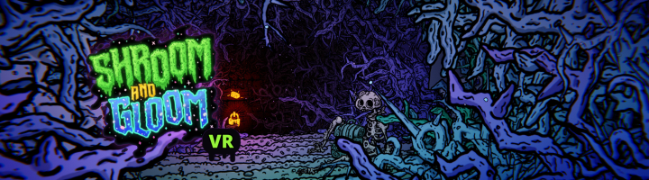
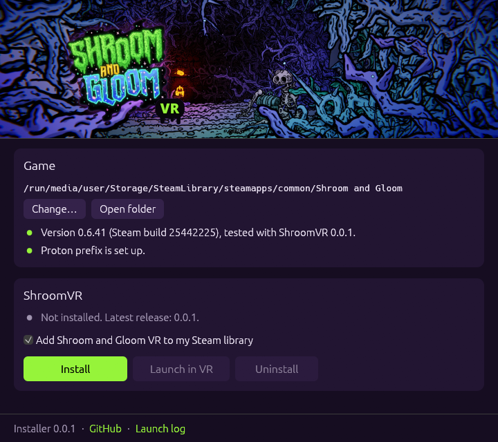

# Shroom and Gloom VR

A VR mod for [Shroom and Gloom](https://store.steampowered.com/app/3271280/) on SteamVR: stereo
rendering, tracked controllers with a laser pointer, your hand of cards and the map held in your hands,
and stick navigation through the game's own controller support. Linux only for now (Proton). Built and
tested with a Steam Frame; Index, Touch and Vive controllers have bindings too.

Fan project, not affiliated with Team Lazerbeam or Devolver Digital.

## Install

1. Start Shroom and Gloom once from Steam, then quit. This sets up its Proton prefix.
2. Download `ShroomVR-Installer-x86_64.AppImage` from the
   [latest release](https://github.com/ojasookert/shroom_and_gloom_vr/releases/latest), make it
   executable and run it.
3. Press **Install**.

The installer finds the game in your Steam libraries, installs BepInEx and the mod, and adds
**Shroom and Gloom VR** to your Steam library (Steam restarts once for that). Play from that entry or with
**Launch in VR**; SteamVR starts first if it isn't running. Starting the game normally stays unmodded.

To update or uninstall, run the installer again. It tells you when your game version hasn't been tested
with a release (`game-versions.json`) and asks before installing anyway. Uninstalling puts the game
back the way it was. The installer also works from a terminal: `--help`.

## Controls (Steam Frame)

| Input | Action |
|---|---|
| Trigger or grip, half pulled | Click / drag with the laser; the hand you pull with takes the laser |
| Either stick, d-pad | Move between cards, targets, room objects and menu items; walk in tunnels |
| A / B | Confirm / back |
| X / Y | Inspect / end turn |
| View / Menu | Deck view / pause |
| Bumpers | Map / sort hand |
| Right stick click | Recenter |

The buttons match the game's gamepad prompts. Using a stick switches the game to its gamepad mode;
aim the laser again and it switches back. Everything can be rebound in SteamVR's controller settings.

Settings are in `BepInEx/config/com.shroomvr.shroomandgloom.cfg` in the game folder: UI distance,
snap/smooth turning (off by default), trigger threshold, card and map sizes, comfort options.

## Building

Needs the .NET 8 SDK, Rust and the game.

- `tools/deploy.sh` builds the mod and copies it into the game (install BepInEx with the installer first).
- `tools/package.sh <version>` builds a release into `dist/`: the mod package, the installer AppImage
  and the manifest the installer reads.
- `tools/make-refs.sh` regenerates `lib/interop`.

`lib/interop` holds reference assemblies generated from the game's interop assemblies with
`tools/refstrip`: type and member signatures only, no code. They let the mod build without the game
installed.

Releases are built by GitHub Actions from `v*` tags. Running the Release workflow by hand tags the next
version (the last number goes up).

## License

The mod and installer source is MIT, see [LICENSE](LICENSE). It doesn't cover:

- `game/Shroom and Gloom_Data/Plugins/x86_64/*.dll`: Valve's OpenVR XR plugin and OpenVR API, BSD 3-Clause
  (`licenses/`). The C# OpenVR bindings in `src/ShroomVR/ThirdParty` are from the same SDK.
- `lib/interop`: generated from Shroom and Gloom, which belongs to Team Lazerbeam / Devolver Digital.
- The game's art, in the `docs/` screenshots and in the library art the installer downloads.
- BepInEx (LGPL-2.1), which the installer downloads.

## Donate

https://ko-fi.com/ojasookert
